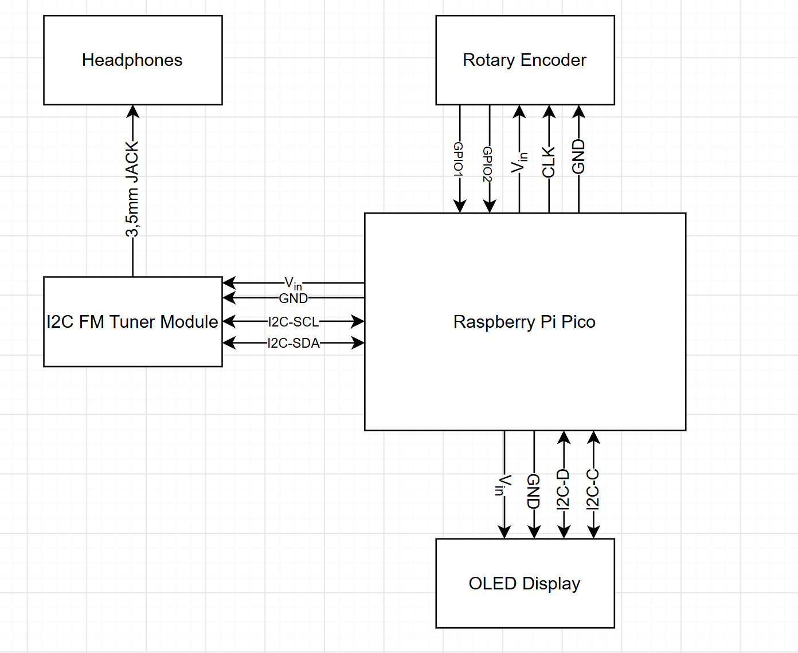

# BPC-DE2_FM_RX
Project for digital electronics course BPC-DE2 on BUT FEEC.

## Team members:
- Marek Mička
- Šimon Tokarčík
- Pavel Trojan
- Alexandr Stoljar 

## Parts list:
- Raspberry Pi Pico W
- I2C FM receiver module
- I2C OLED display
- rotary encoder

## Block diagram  

*Block diagram - may be subject to change*

## Readme - required contents (TO DO list)
- Problem statement and summary of the solution.
- Setup and operating instructions, including required MicroPython modules.
- Hardware inventory and any assumptions or limitations.
- Links to the poster and demonstration video.

