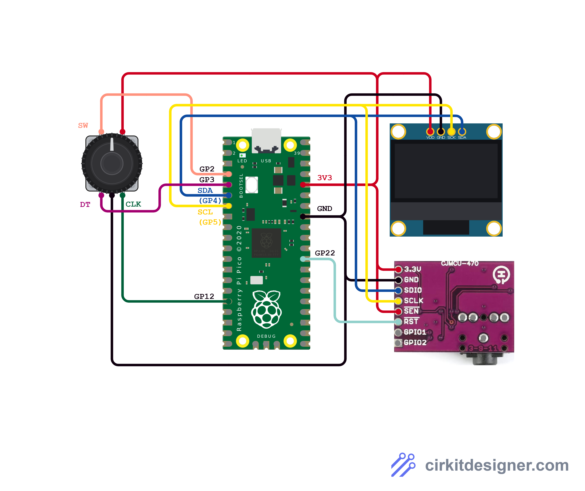
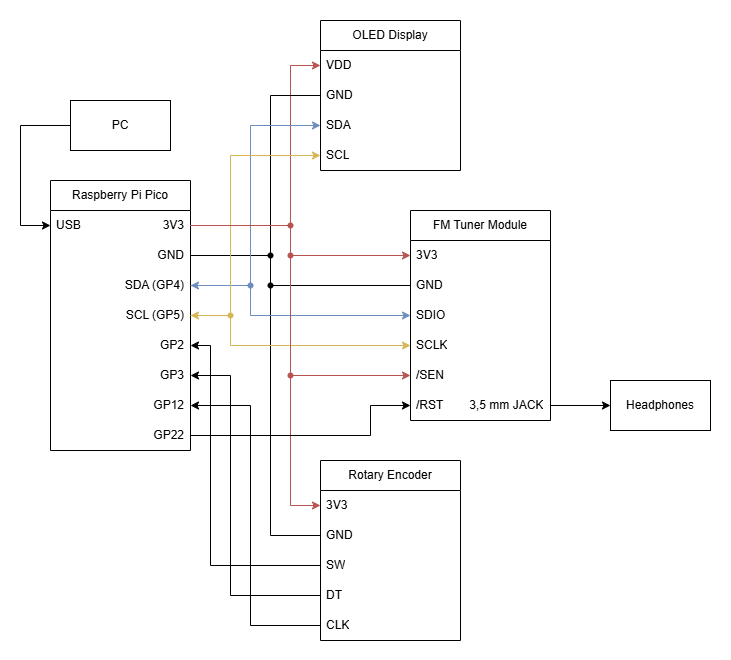
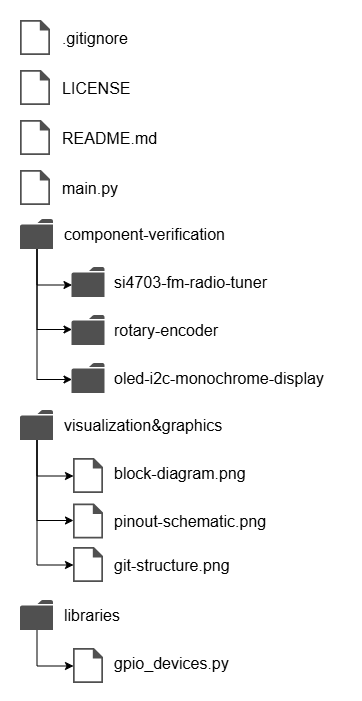
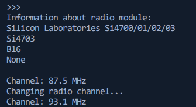
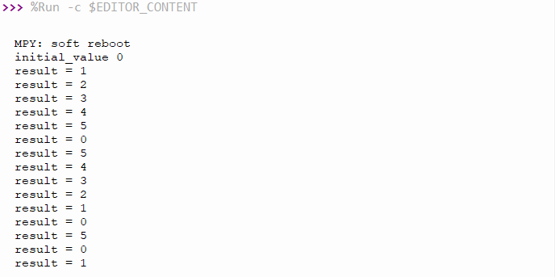
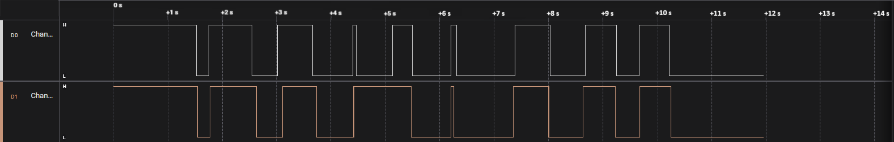
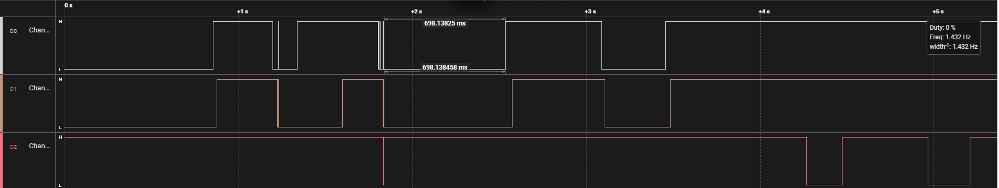
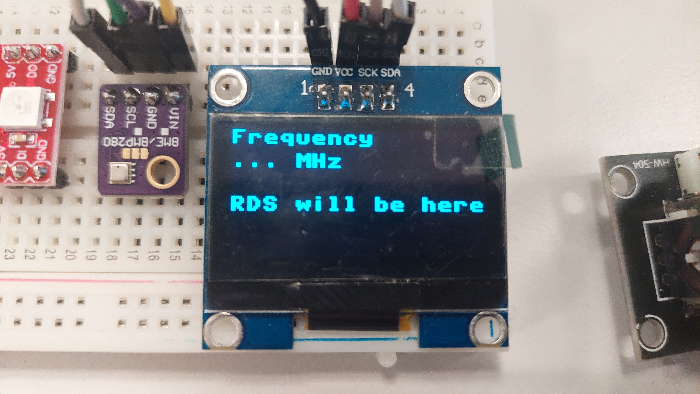
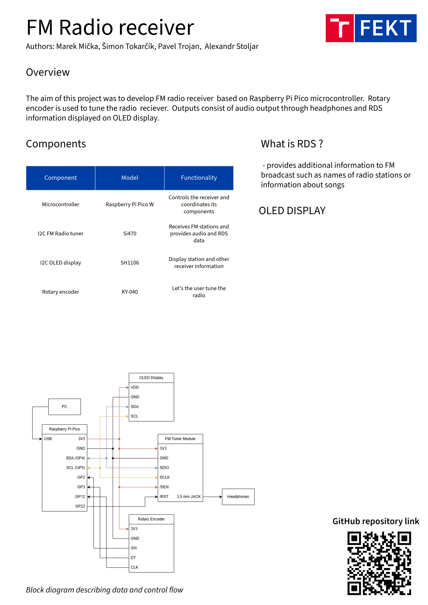

# BPC-DE2_FM_RX
This is a project for digital electronics course BPC-DE2 on BUT FEEC, FM radio receiver with digital tuning. The project's goal is to create a functional FM radio receiver tuned by rotary encoder. Outputs consist of audio output routed to headphones and information such as frequency and RDS text shown on a OLED display.

FM broadcasts can carry Radio Data System (RDS) data alongside the audio signal. This inaudible digital data can include station information and RadioText, such as the currently playing song or other short messages, which a compatible receiver can decode.

## Team members:
- Marek Mička
- Šimon Tokarčík
- Pavel Trojan
- Alexandr Stoljar

## Component list:

| Component | Model | Purpose |
| ------ | -------------- | ------- |
| Microcontroller | [Raspberry Pi Pico W](https://pip-assets.raspberrypi.com/categories/686-raspberry-pi-pico-w/documents/RP-008312-DS-2-pico-w-datasheet.pdf) | Controls the receiver and coordinates its components. |
| I2C FM radio tuner | [Si4703](https://components101.com/sites/default/files/component_datasheet/Si4703-FM-Radio-Tuner-Datasheet.pdf) | Receives FM stations and provides audio and RDS data. |
| I2C OLED display | [SH1106](https://www.displayfuture.com/Display/datasheet/controller/SH1106.pdf) | Displays station and other receiver information. |
| Rotary encoder | [KY-040](https://components101.com/sites/default/files/component_datasheet/KY-04-Rotary-Encoder-Datasheet.pdf) | Lets the user tune the radio. |

## Pinout schematic

*Certain parts of pinout schematic such as GPIO connections may be subject to change*

## Block diagram

*Block diagram may be subject to change*

## Progression and responsibilities
### Week 1
Git creation, agree on project proposal; component list and pin plan; repository structure, creation of block diagram.

| Person | Responsibility |
| ------ | -------------- |
| Marek Mička | Git creation, component research, experimentation with FM module |
| Šimon Tokarčík | Pinout schematic creation, git maintenance, component research |
| Pavel Trojan | Block diagram creation, component research |
| Alexandr Stoljar | Git maintenance, component research |

### Week 2
Component verification, git updates

| Person | Responsibility |
| ------ | -------------- |
| Marek Mička | Setting up FM module |
| Šimon Tokarčík | Setting up FM module |
| Pavel Trojan | OLED display module verification |
| Alexandr Stoljar | Rotary encoder module verification |

### Week 3
Prototyppe creation, integration into main, git updates

| Person | Responsibility |
| ------ | -------------- |
| Marek Mička | Setting up prototype, git updates, documentation |
| Šimon Tokarčík | Setting up prototype, git updates, documentation |
| Pavel Trojan | Adressing mistakes, git updates, documentation |
| Alexandr Stoljar | Adressing mistakes, git updates, documentation |

## Git structure
Currently proposed repository structure:

*Git structure may be subject to change*

## Timing and Concurrency Plan

| Component | Response / Interval |
| ------ | -------------- |
| Rotary Encoder | Interrupt at event |
| FM Module | Response to event of Rotary Encoder |
| OLED Display | Forced update once per 100 ms |
| OLED Display | Flag check for rotary encoder event every 10 ms |

## Module verification
### FM Radio module with Si4703
To control the FM module use a library found on github by Chi Zhang.

[Link to original repository](https://github.com/bh1rio/micropython-si4703/tree/main?tab=BSD-3-Clause-1-ov-file)

In order to correctly initialize out module, original code had to be modified. Instead of passing I2C object to the constructor of Radio class, we pass I2C SDA and SCL pins to it. Then during radio initialization SDA pin needs to be held low while reset pin is taken high, so that the module initializes in 2-wire I2C mode. After that I2C communication is initialized.

*After further development, issues with the passing of I2C object were resolved and the code was restored to its original version.*

#### Console output of FM module verification code

### Rotary Encoder
Rotary encoder is controlled by libraries found on Github by Mike Teachman.

[Link to original repository](https://github.com/miketeachman/micropython-rotary/tree/master)

Turning of the rotary encoder was successfully tested using libraries [rotary.py](libraries/rotary_encoder/rotary.py) and [rotary_irq_rp2.py](libraries/rotary_encoder/rotary_irq_rp2.py) along with temporary [verification code](component-verification/rotary-encoder/encoder_test.py). For clockwise turning - the encoder counts upwards, for counter-clockwise turning the encoder counts downwards.

*Note: During testing of the encoder an important constraint has been discovered. Functionality changes depending on the specific rotary encoder used. Majority of a sample of tested encoder incremets value after every second turn. The issue is that some of them to every turn. This can be solved by setting half_step parameter of RotaryIRQ to True/False depending on the specific encoder used.*

#### Console output of encoder verification code

#### Output of logic analyzer
*The signals from DT and CLK output pins have a phase delay that depends on the direction the encoder is turned. Channel 00 is CLK signal, 01 is DT signal and 02 switch.*

### OLED Display
OLED display was verified using [modified code](component-verification/oled-display/oled.py) originally from [BPC-DE2 course](https://gitlab.fekt.vut.cz/fryza/micropython-course-labs).

#### Picture of verified OLED display

## Poster and video link 

*Demo version of the poster*

Link to the video: 
....

## TO DO list - required contents
- Problem statement and summary of the solution.
- Setup and operating instructions, including required MicroPython modules.
- Hardware inventory and any assumptions or limitations.
- Links to the poster and demonstration video.

## References
- [Raspberry Pi Pico W datasheet](https://pip-assets.raspberrypi.com/categories/686-raspberry-pi-pico-w/documents/RP-008312-DS-2-pico-w-datasheet.pdf)
- [Si4703 FM radio tuner datasheet](https://components101.com/sites/default/files/component_datasheet/Si4703-FM-Radio-Tuner-Datasheet.pdf)
- [SH1106 datasheet](https://www.displayfuture.com/Display/datasheet/controller/SH1106.pdf)
- [KY-040 datasheet](https://components101.com/sites/default/files/component_datasheet/KY-04-Rotary-Encoder-Datasheet.pdf)

- [MicroPython Si4703 library by Chi Zhang](https://github.com/bh1rio/micropython-si4703/tree/main)
- [MicroPython rotary encoder library by Mike Teachman](https://github.com/miketeachman/micropython-rotary/tree/master)
- [MicroPython basic GPIO devices library by Tomáš Frýza](https://gitlab.fekt.vut.cz/fryza/micropython-course-labs/-/blob/main/examples/_modules/gpio_devices.py)

