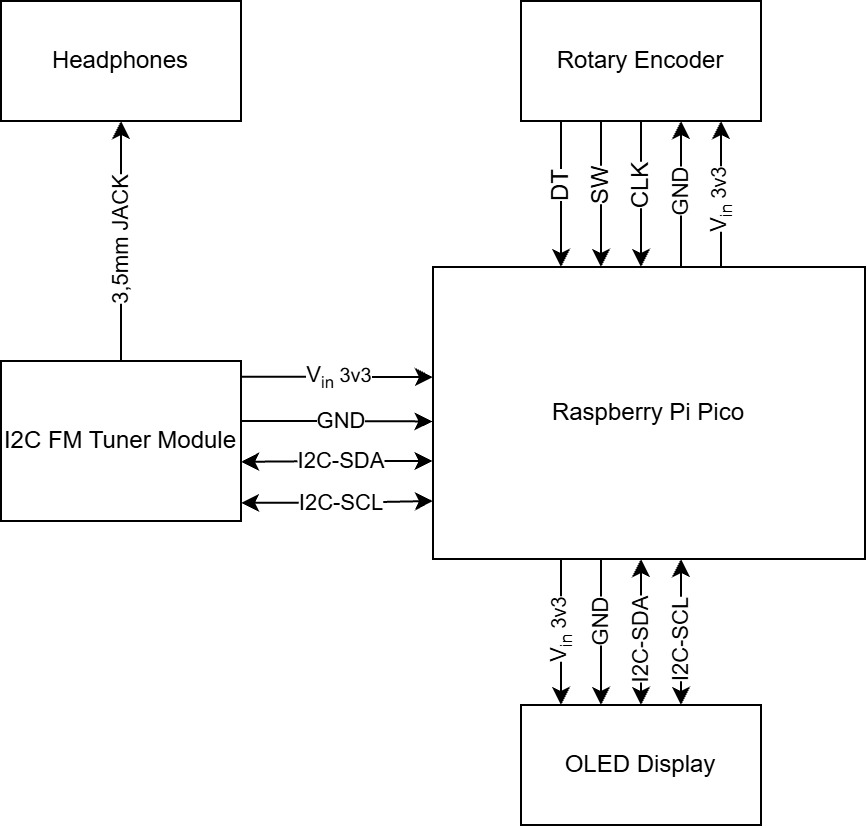
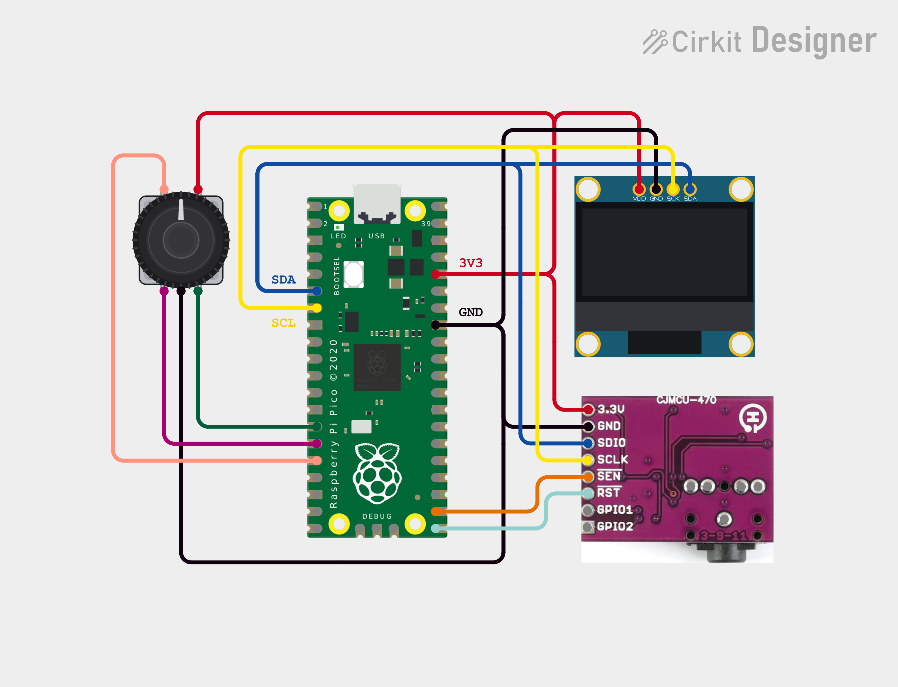
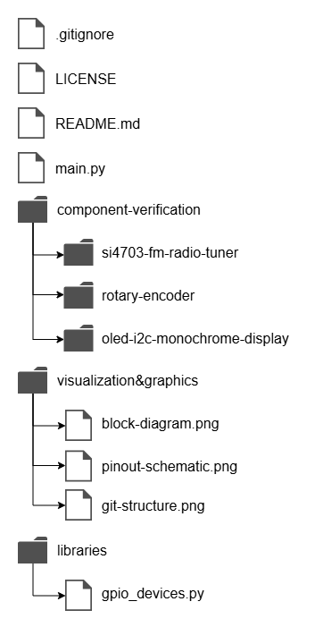
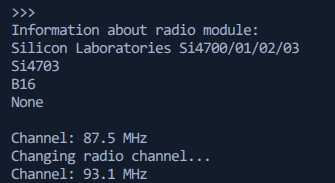

# BPC-DE2_FM_RX
This is a project for digital electronics course BPC-DE2 on BUT FEEC, FM radio receiver with digital tuning. The project's goal is to create a functional FM radio receiver tuned by rotary encoder. Outputs consist of audio output routed to headphones and information shown on a OLED display.

## Team members:
- Marek Mička
- Šimon Tokarčík
- Pavel Trojan
- Alexandr Stoljar

## Component list:

| Component | Model |
| ------ | -------------- |
| Microcontroller | Raspberry Pi Pico W |
| I2C FM radio tuner | Si4073 |
| I2C OLED display | SSD1306 |
| Rotary encoder | Rotary encoder |

## Block diagram

*Block diagram may be subject to change*

## Pinout schematic

*Certain parts of pinout schematic such as GPIO connections may be subject to change*

## Progression and responsibilities
### Week 1
Git creation, agree on project proposal; component list and pin plan; repository structure, creation of block diagram.

| Person | Responsibility |
| ------ | -------------- |
| Marek Mička | Git creation, component research, experimentation with FM module |
| Šimon Tokarčík | Pinout schematic creation, git maintenance, component research |
| Pavel Trojan | Block diagram creation, component research |
| Alexandr Stoljar | Git maintenance, component research |

## Git structure
Currently proposed repository structure:

*Git structure may be subject to change*

## Module verification
### FM Radio module with Si4703
To control the FM module use a library found on github.

[Link to original repository](https://github.com/bh1rio/micropython-si4703/tree/main?tab=BSD-3-Clause-1-ov-file)

In order to correctly initialize out module, original code had to be modified. Instead of passing I2C object to the constructor of Radio class, we pass I2C SDA and SCL pins to it. Then during radio initialization SDA pin needs to be held low while reset pin is taken high, so that the module initializes in 2-wire I2C mode. After that I2C communication is initialized.

#### Console output of module verification code

## Readme - required contents (TO DO list)
- Problem statement and summary of the solution.
- Setup and operating instructions, including required MicroPython modules.
- Hardware inventory and any assumptions or limitations.
- Links to the poster and demonstration video.